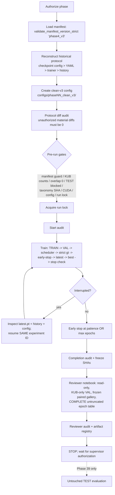
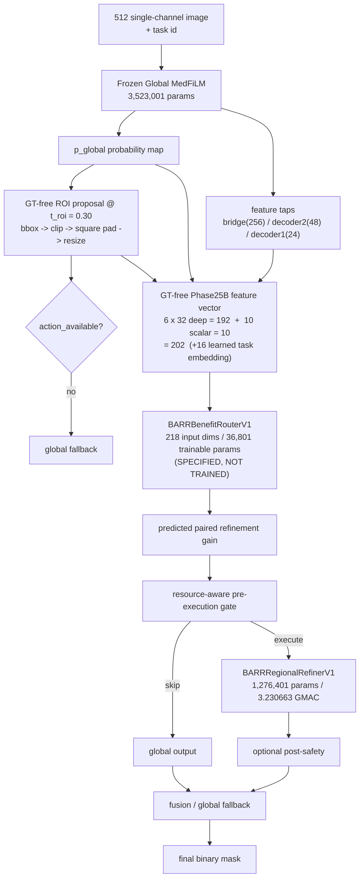

# ARCHITECTURE — System and Repository Architecture

**Purpose:** Describe *how the system is built and where things live* — repository/data/artifact
layout, data flow, the 512 single-channel pipeline, training infrastructure, the model
registry, taxonomy versioning, resume/lock machinery, and the **proposed** future
RA-MedFiLM-Seg++ architecture. See [PRD.md](PRD.md) for goals, [RULES.md](RULES.md) for
constraints, [DESIGN.md](DESIGN.md) for experiment design, [TASKS.md](TASKS.md) for status,
[MEMORY.md](MEMORY.md) for operational handoff.

**Last verified:** 2026-09-30 (Phase-24 router-feature v1.2 closure + governance sync)
**Strategy revision:** **SR-1** — status **ADOPTED**; method name **RA-MedFiLM-BARR**

**Canonical source paths:**
- `src/models/factory.py`, `src/models/*.py` — model registry
- `src/utils/{targets,device,run_lock,test_lock,manifest_guard,config,checkpointing,reproducibility,experiment}.py`
- `src/data/{kub_dataset,transforms}.py` — dataset + transform pipeline
- `src/training/{trainer,evaluator}.py`, `src/metrics/segmentation.py` — training/eval
- `src/analysis/kub_object_size.py` — taxonomy versioning
- `manifests/manifest_registry.*`, `configs/phase09_clean_v3/`, `configs/phase10_clean_v3/`

---

## 1. Repository layout (CURRENT — implemented)

```
D:\Softfors\jup
├── manifests/                 # phase4_v3 (active) + phase4_v2 (historical, root CSVs)
├── configs/
│   ├── phase09_clean_v3/      # phase09_unet_baseline_clean_v3.yaml
│   └── phase10_clean_v3/      # phase10_attention_unet_clean_v3.yaml
│                              # phase10_unetpp_clean_v3.yaml
│                              # phase10_deeplabv3plus_clean_v3.yaml
├── src/
│   ├── models/                # unet, attention_unet, unetpp, deeplabv3plus, factory
│   ├── data/                  # kub_dataset.py, transforms.py
│   ├── training/              # trainer.py, evaluator.py
│   ├── metrics/               # segmentation.py (binary_metrics, aggregate_*, hd95)
│   ├── utils/                 # targets, device, run_lock, test_lock, manifest_guard,
│   │                          # config, checkpointing, reproducibility, experiment
│   └── analysis/              # kub_object_size.py (taxonomy)
├── checkpoints/<experiment_id>/{best.pt,latest.pt}
├── experiments/<experiment_id>/{history.csv,training.log,summary.json?}
├── notebooks/phasewise/phase_NN_*/   # one dir per phase (00 → 40)
├── reports/{audits,tables,figures,qualitative}/
└── docs/                      # THIS handoff pack (documentation only)
```

**Data roots (external to repo):** raw data `D:\Softfors\omni_seg\data_raw`;
external test data `D:\Softfors\final\external_test_ds` (locked); frozen reference
Experiment A `D:\Softfors\final\medfilm_seg_kub_extension` (**MUST NEVER BE MODIFIED**).

> **There is no RA-MedFiLM module, proposal module, or regional pathway in `src/` today.**
> The proposed architecture in §9 is a design, not code. Regional components are
> **conditional** on `REGIONAL_INTEGRATION_GATE_AFTER_PHASE13`; **Phases 14–18 are
> `PENDING_POST_PHASE13_REGIONAL_INTEGRATION_GATE`** and MUST NOT proceed automatically.

## 2. Data / manifest layer

Two manifest generations coexist and must never be conflated (see [PRD.md](PRD.md) §9):

| | `phase4_v3` (active) | `phase4_v2` (historical) |
|---|---|---|
| Location | `manifests/phase4_v3/` | root `manifests/*.csv` |
| Global | TRAIN 5832 / VAL 808 / TEST 1683 / QUAR 118 | TRAIN 5913 / VAL 845 / TEST 1683 |
| KUB | TRAIN 1978 / VAL 280 / TEST 558 / QUAR 4 | TRAIN 1979 / VAL 283 / TEST 558 |

Loading is **version-aware and mandatory** (`src/utils/manifest_guard.py`):

```python
from src.utils.manifest_guard import validate_manifest_version_strict
validate_manifest_version_strict('phase4_v3')
```

`KUBDataset` filters `dataset == "KUB"` **internally** and raises `TestAccessError` if
`split == "TEST"` and `allow_test` is false — TEST construction is blocked at the dataset
layer, not by convention.

## 3. Data flow — the 512 single-channel pipeline (CURRENT)

```
manifest CSV (phase4_v3)
   └─ KUBDataset (filters dataset == KUB, split TRAIN/VAL; TEST blocked)
        ├─ image:  PIL convert("L")        → 1 channel (grayscale)
        ├─ mask:   binarize_mask → mask > 0 → {0,1} float32   (NEVER mask == 1)
        └─ SegmentationTransform:
              aspect-preserving resize (scale = min(512/w, 512/h))
              + centre/symmetric pad to 512×512
              image: BILINEAR   mask: NEAREST
              resize extent uses max(1, round(extent*scale))  (NOT int())
   └─ DataLoader(batch=4, TRAIN shuffle=True + augmentation;
                 VAL shuffle=False, augmentation OFF)
   └─ model (1 input channel → 1 output channel logits)
   └─ sigmoid → threshold 0.5 → binary prediction
   └─ binary_metrics (per-image) → aggregate_binary_metrics (macro = mean of per-image)
```

**Single-channel contract (KUB, current):** 1 input channel at 512×512,
`in_channels=1, out_channels=1`.

> **SR-1 note (future):** the multi-domain phase must **not** blindly force every dataset
> into KUB's 1-channel input merely for implementation convenience. Domain/modality-specific
> lightweight input adapters feeding a shared representation are a **proposed future design**
> ([TASKS.md](TASKS.md) Phase 19).

**VALIDATION aggregation is MACRO:** `binary_metrics` computes per-image tensors;
`aggregate_binary_metrics` concatenates them and takes `.mean()`. This is the
checkpoint-selection metric. Micro aggregates may be reported descriptively but are not
used for selection.

> **Metric trap:** `binary_metrics(logits, targets, threshold)` applies `sigmoid`
> **internally**. Passing already-binary 0/1 masks makes every pixel "foreground"
> (`sigmoid(0)=0.5 >= 0.5`) and yields *identical* scores across models. Pass logits, or
> compute dice/IoU/precision/recall directly with the same formulas and `epsilon = 1e-7`.

## 4. Training infrastructure

Per-epoch ordering (verified from `scripts/training/train_phase10_baselines.py` and
preserved in the clean-v3 runners):

```
TRAIN → VAL → scheduler.step() → strict '>' improvement decision
     → early_stopping.update() → save latest.pt (ALWAYS)
     → save best.pt (only if improved) → stop check
```

Consequences: the LR advances even on the final epoch; the stopping epoch **is**
checkpointed; `strict >` means **ties count as bad epochs**.

Supporting modules:
- `src/utils/device.py` — `get_device(require_cuda=True)`; **fails loudly**, never silently CPU.
- `src/utils/run_lock.py` — single-writer experiment lock; active conflict raises
  `ExperimentLockError`; stale locks require explicit `recover_stale`.
- `src/utils/checkpointing.py` — atomic save/load (model, optimizer, scheduler, GradScaler,
  epoch, best score, early-stop state, RNG states, loader generator states).
- `src/utils/config.py` — explicit config validator (rejects placeholders).
- `src/utils/reproducibility.py`, `src/utils/experiment.py` — seeding / experiment plumbing.

**Resume:** same experiment ID only. Never append `_retry` / `_v2` / `_new` / `_fix` for
ordinary interruption recovery.

## 5. Model registry (clean-v3 status — CURRENT)

`src/models/factory.py` → `create_model(name)`:

| Key | Class | clean-v3 status |
|---|---|---|
| `unet` | `UNet` | **TRAINED** (Phase 09) |
| `attention_unet` | `AttentionUNet` | **TRAINED** (Phase 10 Part 1A) |
| `unetpp` / `unetplusplus` | `UNetPlusPlus` | **TRAINED** (Phase 10 Part 1B) |
| `deeplabv3plus` / `deeplabv3_plus` | `DeepLabV3Plus` | **TRAINED** (Phase 10 Part 1C) |

> **All four baseline architectures have clean-v3 runs.** DeepLabV3+ is
> `deeplabv3plus_resnet50_os16` — ResNet-50, **no pretrained weights**, output stride 16,
> ASPP rates (6,12,18) + image pooling, no auxiliary head, **40,340,769 parameters**
> (proven by instantiating the model and loading the historical state-dict with zero
> missing/unexpected keys).
>
> **Current phase state:**
>
> - **Phase 10: COMPLETE** (all four baselines + final four-model descriptive comparison)
> - **Phase 11: COMPLETE** (Part 1A protocol freeze + Part 1B four-model failure analysis)
> - **Phase 12: COMPLETE / PASS** (1A protocol freeze · 1B four-model oracle inference ·
>   1C paired mechanism analysis · 1D supervisor conclusion)
> - **Phase 13: Parts 1A / 1A-R1 / 1A-R2 COMPLETE** — historical localizer reconstruction +
>   supervisor protocol freeze + checkpoint-selection provenance correction; current clean-v3
>   localizer protocol **`SUPERVISOR_FROZEN_R2`** ·
>   **Part 1B ELIGIBLE but NOT AUTHORIZED** (GT-Free Region Proposal / Localization)
> - Oracle mechanism: **`SUPPORTED_DESCRIPTIVE_EVIDENCE`**
> - Regional integration gate: **`NOT_DECIDED`** (decided only after Phase 13)
> - Regional mechanism: **NOT PROMOTED**
> - `RA-MedFiLM-Seg++`: **`PROPOSED_NOT_IMPLEMENTED`**
> - **No baseline winner; no reference model; no significance testing performed.**
>   TEST locked until **Phase 39**.

## 6. Taxonomy versioning

`src/analysis/kub_object_size.py` carries **two** taxonomy IDs and keeps them separate:

- `kub_size_v1` — **HISTORICAL, FROZEN, IMMUTABLE**.
- `kub_size_clean_v3_v1` — **clean-v3, FROZEN**, loaded from
  `reports/audits/kub_size_clean_v3_v1_thresholds.json` (fails loudly if absent).
  See [DESIGN.md](DESIGN.md) §4 for quantiles.

Load via `get_kub_size_taxonomy(taxonomy_id)`. Never conflate or cross-label.
**FULL_FIELD scope only**; ROI = `ROI_NOT_PRIMARY_BINNED`.

## 7. Component spaces — do not mix (CURRENT contract)

| Space | Used for |
|---|---|
| **ORIGINAL_NATIVE** | GT component identity, size taxonomy (`kub_size_clean_v3_v1`), native component count, multi-component membership |
| **EVALUATION_512** | predicted connected components, FP predicted components, GT/pred overlap for evaluation, object recall at model resolution |

Connectivity **8**; a GT component is **detected** if it overlaps a prediction by
`>= 1` pixel. Never merge the spaces silently (resize/padding can merge components).

## 8. Experiment lifecycle (Mermaid)



## 9. CURRENT RA-MedFiLM-BARR ARCHITECTURE (frozen components + router)

> **Status: method name `RA-MedFiLM-BARR` (v1.1).**
> The global model and the regional refiner are **implemented, trained and frozen**.
> The benefit router is **specified and frozen in contract only — NOT trained**, and
> **Phase25B (GT-free pre-refinement feature extraction) is `REENTRY_ELIGIBLE_NOT_STARTED`**.
> Nothing in this section may be used to claim a trained router or a routing result.

### 9.1 End-to-end flow



### 9.2 Frozen model components

| Component | Params | Cost | Status |
|---|---|---|---|
| **Global MedFiLM** | 3,523,001 | — | **FROZEN** (Phase-21; checkpoint SHA `286689fd…`) |
| **BARRRegionalRefinerV1** (`R_psi`) | 1,276,401 | 3.230663 GMAC | **FROZEN** (Phase-25A canonical; checkpoint SHA `6d28608a…`) |
| **BARRBenefitRouterV1** (`B_phi`) | 36,801 | — | **SPECIFIED, NOT TRAINED** (historical linear-core bookkeeping value: **36,353**) |

Global MedFiLM signature: `G(x, t) → (p_global, F_global)`. FiLM sites:
`bridge, decoder4, decoder3, decoder2, decoder1` over channels `(24, 48, 96, 192, 256)`.

Canonical refiner channels: `(16, 32, 64, 96, 128)`.

### 9.3 Feature dimensions (the router input contract, v1.2)

| Quantity | Value |
|---|---|
| deep feature groups | 6 (bridge/decoder2/decoder1 × global/ROI) |
| deep feature width per group | 32 |
| deep features total | **6 × 32 = 192** |
| scalar descriptors | **10** |
| **pre-router numeric (Phase25B matrix)** | **202** |
| learned task embedding (Phase25D) | **16** |
| **router input** | **218** |

Native tap channel widths: **bridge = 256**, **decoder2 = 48**, **decoder1 = 24**.
Because `C ≠ 32`, each tap map is reduced by the frozen
`DETERMINISTIC_CHANNEL_ADAPTIVE_AVG_POOL_1D_V1` operator (non-trainable; uses every
source channel).

The ten scalars: `entropy_proxy_mean`, `frac_prob_within_0p05_of_boundary`,
`frac_prob_within_0p02_of_boundary`, `mean_boundary_margin`, `pred_foreground_fraction`,
`pred_foreground_pixels`, `pred_roi_exists`, `pred_empty`,
`predicted_roi_area_fraction`, `predicted_roi_side`.

### 9.4 Threshold box (two DIFFERENT thresholds — never conflate)

```
ROI proposal threshold          = 0.30   (bbox -> action_available / FORCED_SKIP)
segmentation output threshold   = 0.50   (final mask / Dice / IoU)
```

`predicted_roi_area_fraction` is the **clipped in-canvas** area fraction
(`max(0,min(512,x2)-max(0,x1)) * max(0,min(512,y2)-max(0,y1)) / 512²`), in `[0,1]`;
external padding is excluded. `predicted_roi_side` separately retains the pre-resize
square crop side.

### 9.5 Novelty accounting (mandatory honesty)

**Novelty-bearing:** the **learned, GT-free, pre-execution paired-refinement-gain
routing** in the *integrated* system. Maximum claim level **= Level 2**, scoped to the
integrated GT-free paired-gain router. Never "first to…".

**Non-novel (prior art / ordinary engineering):** the regional refiner; an ordinary
gate; a resource penalty; post-safety; fusion; global fallback; the paired supervised
gain estimand itself.

## 10. Artifact immutability model

Once a run completes, these are **frozen evidence**: `configs/…`,
`experiments/<id>/history.csv`, `checkpoints/<id>/{best,latest}.pt`, per-phase audits, and
reviewer notebooks (re-noted by SHA). Reviewer/support code is read-only by construction —
no optimizer steps, no checkpoint writes, no TEST access.

---

**Cross-links:** [PRD.md](PRD.md) · [RULES.md](RULES.md) · [DESIGN.md](DESIGN.md) ·
[TASKS.md](TASKS.md) · [MEMORY.md](MEMORY.md)
