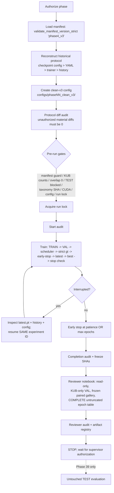
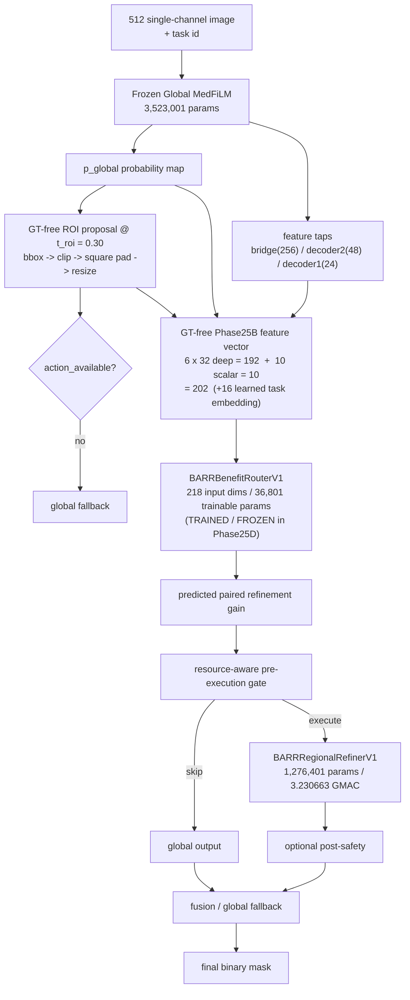

# ARCHITECTURE — System and Repository Architecture

## Phase25E policy evaluation complete — current state (2026-10-01)

Phase25D: **COMPLETE_CANONICAL / TRAINED / FROZEN**. Phase25E resource-gate specification: **COMPLETE_FROZEN** (`ra_medfilm_barr_resource_gate_v1_0`). Phase25E scientific policy evaluation: **COMPLETE_FROZEN**. Phase25F post-safety specification v1.0 (`ra_medfilm_barr_post_safety_v1_0`): **COMPLETE_FROZEN** (execution **COMPLETE_CANONICAL**). Phase25G specification v1.1: **COMPLETE_FROZEN**; Phase25G: **COMPLETE_CANONICAL** (ROUTER_DEVELOPMENT only; ROUTER_HOLDOUT RESERVED_UNOPENED_FOR_PHASE30). **Phase25 = COMPLETE_CANONICAL**; Phase26 = **ELIGIBLE_NOT_STARTED**.

The normalized incremental action cost is exactly `3,230,662,656 / 31,551,740,928` (`1051648/10270749`, approximately `0.10239253242387678`) for available actions; unavailable actions cost zero and are FORCED_SKIP. Pre-gate router overhead is `36,160` Conv/Linear MACs, separate from action cost. All compute is **ANALYTICAL MAC LOWER BOUND**, never measured latency.

Lambdas `{0.00, 0.25, 0.50, 1.00}` and budgets `{0%, 10%, 25%, 50%, 100%}` are frozen. All 4,957 DEV rows are action-available; exact top-K counts are `{0, 495, 1239, 2478, 4957}`. Rank by score descending, sample_id ascending. C6 uses negative predicted ROI area, a prospective geometry heuristic. Random priorities (PCG64 seed 42) and 45 label-blind memberships are frozen before outcomes. Under constant action cost, C7 and C8 have **identical membership at every fixed budget and lambda**; they are not independent evidence.

The 45 frozen OOF memberships were joined to the frozen Phase25C paired-gain outcomes on ROUTER_DEVELOPMENT only (4957). Statistics (domain-stratified group bootstrap, 2000 replicates, seed 42) and final-router DEV thresholds were frozen **before** the outcome join. Result: under the frozen PRIMARY statistic (raw paired two-sided p), C7 **significantly beats every simple GT-free proxy on precision@budget at the 10% and 25% budgets**, the advantage shrinking to non-significance at 50% (Holm-Bonferroni retained only as a secondary sensitivity: 10%); preservation holds; a usable accuracy-compute frontier exists. H1 is scoped to the tight and medium budgets (10%/25%).

The frozen final benefit-router checkpoint was loaded once and run in a single outcome-blind forward pass over the 4,957 ROUTER_DEVELOPMENT feature rows (no global-model forward, no regional-refiner forward, no training); no lambda was selected; C9 post-safety was not evaluated. ROUTER_HOLDOUT and VAL808 remain untouched; TEST remains locked until Phase39.

Executed scientific notebook: `notebooks/phasewise/phase_25e_resource_gate/phase25e_resource_gate.ipynb`; SHA-256 `b587cc925fa178f1a0eaaa986caa3cb77dbc71ecd9fd520312af7f2097091797` (3× byte-identical; post-reconciliation rebuild superseding the archived pre-reconciliation build SHA `e5d8f5657b43a18fd87e50bcf6f4834bcdd94dcbb2def0ef02ce720f0f1d7718`). Evidence: `reports/audits/phase25e_policy_evaluation_summary.json`, `reports/audits/phase25e_adjudication.json` (original closure), `reports/audits/phase25e_adjudication_reconciled.json` (PRIMARY adjudication, raw paired p), `reports/audits/phase25e_multiplicity_provenance_audit.json`, `reports/audits/phase25e_final_freeze.json`.

Terminal: `PHASE25E_RESOURCE_GATE_POLICY_EVALUATION_COMPLETE__OOF_FIXED_BUDGET_FRONTIER_AND_FINAL_DEV_THRESHOLDS_FROZEN__PHASE25F_ELIGIBLE_NOT_STARTED`.

## Phase25F post-safety specification v1.0 — COMPLETE_FROZEN (2026-10-01)

Phase25F post-safety specification (`ra_medfilm_barr_post_safety_v1_0`): **COMPLETE_FROZEN**; Phase25F execution: **EXECUTION_ELIGIBLE_NOT_STARTED**. The first blocked Phase25F attempt (`PHASE25F_BLOCKED__POST_SAFETY_EXECUTION_SPEC_INCOMPLETE`; 54 blocking fields, 12 hard-stop conditions) is preserved verbatim as **BLOCKED_ATTEMPT_PROVENANCE** (no audit overwritten or deleted).

The repair prospectively froze the exact S_omega input vector (20-D = 16 numeric + 4 one-hot task), the leakage-safe OOF post-refinement source (Phase25C fold-specific `_tmp_refined_crop_prob_<DOMAIN>.npy`, provenance-proven and promoted to `data_cache/phase25f_barr_post_safety_v1_0/oof_refined_crop_prob.npy`), `BARRPostSafetyV1` (`Linear(20,32)->SiLU->Linear(32,16)->SiLU->Linear(16,1)`, **1,217** trainable parameters, raw logit output), the training objective (`BCEWithLogitsLoss`, mean reduction, no class weighting / pos_weight / label smoothing), the reused Phase25D five-fold CV identity manifests (FIT / EARLY_STOP / OUTER_TARGET), FIT-only ddof=0 normalization of the 16 numeric features, the fixed ACCEPT/FALLBACK threshold (`sigmoid >= 0.50` / `logit >= 0.0`; distinct from the 0.30 ROI-proposal and 0.50 segmentation-output thresholds), the Phase25E SKIP interaction state machine, the final-refit rule (exact median of the five best epochs, seed 42, LAST_FIXED_EPOCH checkpoint), and A7/A8 ownership (Phase25F constructs the C9 artifact on ROUTER_DEVELOPMENT; Phase25G owns the integrated A7-vs-A8 / C8-vs-C9 evaluation).

All 73 specification fields are now complete; `blocking_fields = []` and `hard_stop_conditions_triggered = []`. **No model was constructed, no training ran, no forward pass occurred, no refinement or DeltaDice was regenerated, and no threshold was tuned.** ROUTER_HOLDOUT, VAL808 and TEST remain closed; Phase25G is NOT_STARTED.

Evidence: `reports/audits/phase25f_post_safety_spec_completion_v1_0.json`, `phase25f_oof_refinement_source_contract_v1_0.json`, `phase25f_oof_refinement_source_promotion.json`, `phase25f_feature_equation_contract_v1_0.json`, `phase25f_feature_cache_determinism.json`, `phase25f_target_contract_v1_0.json`, `phase25f_architecture_contract_v1_0.json`, `phase25f_training_contract_v1_0.json`, `phase25f_decision_threshold_contract_v1_0.json`, `phase25f_state_machine_contract_v1_0.json`, `phase25f_final_refit_contract_v1_0.json`, `phase25f_a7_a8_ownership_ruling_v1_0.json`, `phase25f_spec_repair_no_execution.json`, `phase25f_spec_repair_final_check.json`.

Terminal: `PHASE25F_POST_SAFETY_SPEC_V1_0_COMPLETE__OOF_FEATURE_SOURCE_ARCHITECTURE_TRAINING_THRESHOLD_AND_OWNERSHIP_FROZEN__PHASE25F_EXECUTION_ELIGIBLE_NOT_STARTED`.

## Phase25F post-safety execution — COMPLETE_CANONICAL (2026-10-01)

`BARRPostSafetyV1` (`Linear(20,32)->SiLU->Linear(32,16)->SiLU->Linear(16,1)`, **1,217** trainable parameters, raw logit) was constructed and trained for exactly **five frozen CV logical runs** (seeds 54000–54004; reused Phase25D FIT/EARLY_STOP/OUTER_TARGET manifests) plus **one all-DEV final refit** (`FINAL_SAFETY_EPOCHS = 23` = exact integer median of the five selected epochs; seed 42; LAST_FIXED_EPOCH checkpoint). **4,957 OOF safety logits / probabilities / decisions** were produced on ROUTER_DEVELOPMENT and are bit-reproducible (3x replay, max abs difference 0.0). The **C9 post-safety state/decision artifact** (20 frozen C8 lambda×budget policies × 4,957 rows) was constructed. Classifier-level metrics describe S_omega itself at the fixed 0.50 threshold; they are **not** segmentation results and **not** a preservation proof.

**Scope**: no A7-vs-A8 segmentation comparison, no C8-vs-C9 system-performance comparison, no preservation adjudication, no new budget/lambda selection, no threshold tuning. ROUTER_HOLDOUT, VAL808 and TEST were never read; TEST stays locked until Phase39. Phase25G owns the integrated controlled development evaluation and is **ELIGIBLE_NOT_STARTED**.

Executed notebook: `notebooks/phasewise/phase_25f_post_safety/phase25f_post_safety_execution.ipynb` (41 sections; 9 figures; 3x byte-identical SHA-256 `1ba9c08bee97e95926994b11268017e8d6b45150929ebe6edfca4dfe95715c90`).

Terminal: `PHASE25F_POST_SAFETY_EXECUTION_COMPLETE__OOF_SAFETY_PREDICTIONS_FINAL_CHECKPOINT_AND_C9_ARTIFACTS_FROZEN__PHASE25G_ELIGIBLE_NOT_STARTED`.

## Phase25G specification v1.1 — COMPLETE_FROZEN (2026-10-01)

Phase25F execution: **COMPLETE_CANONICAL**. Phase25G specification v1.1 (`ra_medfilm_barr_integrated_evaluation_v1_0`): **COMPLETE_FROZEN**; Phase25G: **COMPLETE_CANONICAL** (ROUTER_DEVELOPMENT only).

**SUPERVISOR RULING (G1)**: ROUTER_HOLDOUT phase ownership = **Phase30** (Final Development Validation Benchmark), one-shot clean out-of-sample development validation. ROUTER_HOLDOUT = **RESERVED_UNOPENED_FOR_PHASE30**; it MUST NOT be opened by Phase25G, Phase26, Phase27, Phase28 or Phase29. Phase30 is the first eligible owner, subject to a separate pre-execution one-shot protocol freeze. The ruling is additive / prospective / pre-outcome (`science_changed = false`) and resolves the single Phase25G governance blocker.

Phase25G population = **ROUTER_DEVELOPMENT (4957)**; evaluation sources: Phase25C OOF delta_dice, Phase25E frozen prospective C8 memberships, Phase25F OOF S_omega probabilities/decisions and the Phase25F C9 manifest (no new model inference). The repaired completeness matrix (`phase25g_specification_completeness_v1_1.csv`) has 28 rows, `blocking_fields = []`, `hard_stop_conditions = []`; the five conditional holdout-execution fields are marked `NOT_APPLICABLE_TO_PHASE25G__HOLDOUT_RESERVED_FOR_PHASE30`.

**Blocked provenance preserved**: the pre-ruling state `PHASE25G_BLOCKED__ONE_SHOT_HOLDOUT_OWNERSHIP_UNRESOLVED` (spec `INCOMPLETE__HOLDOUT_OWNERSHIP_UNRESOLVED`, blocking field `ROUTER_HOLDOUT ownership`) and its artifacts remain verbatim (no audit or table overwritten).

Current state: **Phase25 = COMPLETE_CANONICAL (25A-25G)**; Phase26 = ELIGIBLE_NOT_STARTED; ROUTER_HOLDOUT = RESERVED_UNOPENED_FOR_PHASE30; Phase30 = NOT_STARTED; VAL808 = UNOPENED / continuity benchmark; TEST = LOCKED UNTIL PHASE39.

Evidence: `reports/audits/phase25g_router_holdout_ownership_supervisor_ruling_v1_0.json`, `phase25g_holdout_reservation_for_phase30.json`, `phase25g_specification_repair_addendum.json`, `phase25g_specification_final_check_v1_1.json`, `phase25g_specification_governance_v1_1.json`, `phase25g_holdout_ownership_repair_final_check.json`, `phase30_router_holdout_deferred_contract_stub.json`.

Terminal: `PHASE25G_SPEC_V1_1_COMPLETE__ROUTER_HOLDOUT_RESERVED_FOR_PHASE30__DEV_ONLY_INTEGRATED_EVALUATION_FROZEN__PHASE25G_EXECUTION_ELIGIBLE_NOT_STARTED`.

## Phase25G integrated controlled development evaluation — COMPLETE_CANONICAL (2026-10-01)

Phase25G (`CANONICAL_PHASE25G_INTEGRATED_CONTROLLED_DEVELOPMENT_EVALUATION`, spec `ra_medfilm_barr_integrated_evaluation_v1_0`, repair v1.1) evaluated **A7 (C8: learned-gain + resource gate, always accept)** against **A8 (C9: same membership + S_omega post-safety)** over the complete frozen 20-policy grid (lambda {0.00,0.25,0.50,1.00} x budget {0,10,25,50,100%}) on **ROUTER_DEVELOPMENT (n=4957)**, reconstructed entirely from the frozen Phase25C OOF `delta_dice`, the Phase25E prospective C8 memberships and the Phase25F C9 decision manifest.

**No model was constructed, no training ran, no forward pass occurred, no refinement or DeltaDice was regenerated, and no threshold was tuned.** Evidence class = `CONTROLLED_META_LEVEL_OOF_DEVELOPMENT_EVIDENCE`.

**Lambda redundancy**: because the action cost is constant, C8 membership is structurally identical across lambda for a fixed budget — the four lambda replicas are **DUPLICATE MEMBERSHIP**, so only **5 unique membership sets** carry inferential weight.

**Results (5 unique budgets)**: post-safety (A8) weakly improves the macro-domain Dice delta at every informative budget and **reduces harmful replacements** (delta_dice < 0) monotonically with budget; preservation holds for every frozen policy (macro-domain lower 95% CI > -0.005). H3 is reported **descriptively only** — no numeric success threshold was pre-registered (`H3_NUMERICAL_SUCCESS_THRESHOLD_NOT_PRE_REGISTERED = true`). S_omega adds an analytical `a * 1168` MAC increment and **saves no compute**.

**No policy selected**: `lambda_selected = false`, `best_budget_selected = false`, `policy_selected = false`. R1/R2/R3/F1 belong to Phase28; C11 = `C11_NOT_EXECUTED`.

Notebook: `notebooks/phasewise/phase_25g_controlled_validation/phase25g_integrated_controlled_evaluation.ipynb` (SHA-256 `5f6b6642fe013d9ad69cac8a0e319d5f86362d8457febdab42fde6cbe14c4487`, 41 sections, 9 figures, 3x byte-identical).

Evidence: `reports/audits/phase25g_final_freeze.json`, `phase25g_reconstruction_integrity.json`, `phase25g_a7_a8_identity_control_audit.json`, `phase25g_preservation_adjudication.json`, `phase25g_h3_result.json`, `phase25g_compute_accounting_audit.json`, `phase25g_notebook_determinism.json`, `reports/tables/phase25g_c8_c9_comparison.csv`.

Current state: **Phase25 = COMPLETE_CANONICAL (25A-25G)**; Phase26 = ELIGIBLE_NOT_STARTED; ROUTER_HOLDOUT = RESERVED_UNOPENED_FOR_PHASE30; Phase30 = NOT_STARTED; VAL808 = UNOPENED; TEST = LOCKED UNTIL PHASE39.

Terminal: `PHASE25G_INTEGRATED_CONTROLLED_DEVELOPMENT_EVALUATION_COMPLETE__A7_A8_C8_C9_PRESERVATION_AND_H3_FROZEN__PHASE25_COMPLETE__PHASE26_ELIGIBLE_NOT_STARTED`.


**Purpose:** Describe *how the system is built and where things live* — repository/data/artifact
layout, data flow, the 512 single-channel pipeline, training infrastructure, the model
registry, taxonomy versioning, resume/lock machinery, and the **proposed** future
RA-MedFiLM-Seg++ architecture. See [PRD.md](PRD.md) for goals, [RULES.md](RULES.md) for
constraints, [DESIGN.md](DESIGN.md) for experiment design, [TASKS.md](TASKS.md) for status,
[MEMORY.md](MEMORY.md) for operational handoff.

**Last verified:** 2026-10-01 — Phase25G integrated controlled development evaluation COMPLETE_CANONICAL (A7 vs A8 / C8 vs C9 / preservation / H3 frozen; Phase25 = COMPLETE_CANONICAL; Phase26 ELIGIBLE_NOT_STARTED; ROUTER_HOLDOUT RESERVED_UNOPENED_FOR_PHASE30; TEST LOCKED UNTIL PHASE39)
**Strategy revision:** **SR-1** — status **ADOPTED**; method name **RA-MedFiLM-BARR**

**Canonical source paths:**
- `src/models/factory.py`, `src/models/*.py` — model registry
- `src/utils/{targets,device,run_lock,test_lock,manifest_guard,config,checkpointing,reproducibility,experiment}.py`
- `src/data/{kub_dataset,transforms}.py` — dataset + transform pipeline
- `src/training/{trainer,evaluator}.py`, `src/metrics/segmentation.py` — training/eval
- `src/analysis/kub_object_size.py` — taxonomy versioning
- `manifests/manifest_registry.*`, `configs/phase09_clean_v3/`, `configs/phase10_clean_v3/`

---

## 1. Repository layout (CURRENT — implemented)

```
D:\Softfors\jup
├── manifests/                 # phase4_v3 (active) + phase4_v2 (historical, root CSVs)
├── configs/
│   ├── phase09_clean_v3/      # phase09_unet_baseline_clean_v3.yaml
│   └── phase10_clean_v3/      # phase10_attention_unet_clean_v3.yaml
│                              # phase10_unetpp_clean_v3.yaml
│                              # phase10_deeplabv3plus_clean_v3.yaml
├── src/
│   ├── models/                # unet, attention_unet, unetpp, deeplabv3plus, factory
│   ├── data/                  # kub_dataset.py, transforms.py
│   ├── training/              # trainer.py, evaluator.py
│   ├── metrics/               # segmentation.py (binary_metrics, aggregate_*, hd95)
│   ├── utils/                 # targets, device, run_lock, test_lock, manifest_guard,
│   │                          # config, checkpointing, reproducibility, experiment
│   └── analysis/              # kub_object_size.py (taxonomy)
├── checkpoints/<experiment_id>/{best.pt,latest.pt}
├── experiments/<experiment_id>/{history.csv,training.log,summary.json?}
├── notebooks/phasewise/phase_NN_*/   # one dir per phase (00 → 40)
├── reports/{audits,tables,figures,qualitative}/
└── docs/                      # THIS handoff pack (documentation only)
```

**Data roots (external to repo):** raw data `D:\Softfors\omni_seg\data_raw`;
external test data `D:\Softfors\final\external_test_ds` (locked); frozen reference
Experiment A `D:\Softfors\final\medfilm_seg_kub_extension` (**MUST NEVER BE MODIFIED**).

> **There is no RA-MedFiLM module, proposal module, or regional pathway in `src/` today.**
> The proposed architecture in §9 is a design, not code. Regional components are
> **conditional** on `REGIONAL_INTEGRATION_GATE_AFTER_PHASE13`; **Phases 14–18 are
> `PENDING_POST_PHASE13_REGIONAL_INTEGRATION_GATE`** and MUST NOT proceed automatically.

## 2. Data / manifest layer

Two manifest generations coexist and must never be conflated (see [PRD.md](PRD.md) §9):

| | `phase4_v3` (active) | `phase4_v2` (historical) |
|---|---|---|
| Location | `manifests/phase4_v3/` | root `manifests/*.csv` |
| Global | TRAIN 5832 / VAL 808 / TEST 1683 / QUAR 118 | TRAIN 5913 / VAL 845 / TEST 1683 |
| KUB | TRAIN 1978 / VAL 280 / TEST 558 / QUAR 4 | TRAIN 1979 / VAL 283 / TEST 558 |

Loading is **version-aware and mandatory** (`src/utils/manifest_guard.py`):

```python
from src.utils.manifest_guard import validate_manifest_version_strict
validate_manifest_version_strict('phase4_v3')
```

`KUBDataset` filters `dataset == "KUB"` **internally** and raises `TestAccessError` if
`split == "TEST"` and `allow_test` is false — TEST construction is blocked at the dataset
layer, not by convention.

## 3. Data flow — the 512 single-channel pipeline (CURRENT)

```
manifest CSV (phase4_v3)
   └─ KUBDataset (filters dataset == KUB, split TRAIN/VAL; TEST blocked)
        ├─ image:  PIL convert("L")        → 1 channel (grayscale)
        ├─ mask:   binarize_mask → mask > 0 → {0,1} float32   (NEVER mask == 1)
        └─ SegmentationTransform:
              aspect-preserving resize (scale = min(512/w, 512/h))
              + centre/symmetric pad to 512×512
              image: BILINEAR   mask: NEAREST
              resize extent uses max(1, round(extent*scale))  (NOT int())
   └─ DataLoader(batch=4, TRAIN shuffle=True + augmentation;
                 VAL shuffle=False, augmentation OFF)
   └─ model (1 input channel → 1 output channel logits)
   └─ sigmoid → threshold 0.5 → binary prediction
   └─ binary_metrics (per-image) → aggregate_binary_metrics (macro = mean of per-image)
```

**Single-channel contract (KUB, current):** 1 input channel at 512×512,
`in_channels=1, out_channels=1`.

> **SR-1 note (future):** the multi-domain phase must **not** blindly force every dataset
> into KUB's 1-channel input merely for implementation convenience. Domain/modality-specific
> lightweight input adapters feeding a shared representation are a **proposed future design**
> ([TASKS.md](TASKS.md) Phase 19).

**VALIDATION aggregation is MACRO:** `binary_metrics` computes per-image tensors;
`aggregate_binary_metrics` concatenates them and takes `.mean()`. This is the
checkpoint-selection metric. Micro aggregates may be reported descriptively but are not
used for selection.

> **Metric trap:** `binary_metrics(logits, targets, threshold)` applies `sigmoid`
> **internally**. Passing already-binary 0/1 masks makes every pixel "foreground"
> (`sigmoid(0)=0.5 >= 0.5`) and yields *identical* scores across models. Pass logits, or
> compute dice/IoU/precision/recall directly with the same formulas and `epsilon = 1e-7`.

## 4. Training infrastructure

Per-epoch ordering (verified from `scripts/training/train_phase10_baselines.py` and
preserved in the clean-v3 runners):

```
TRAIN → VAL → scheduler.step() → strict '>' improvement decision
     → early_stopping.update() → save latest.pt (ALWAYS)
     → save best.pt (only if improved) → stop check
```

Consequences: the LR advances even on the final epoch; the stopping epoch **is**
checkpointed; `strict >` means **ties count as bad epochs**.

Supporting modules:
- `src/utils/device.py` — `get_device(require_cuda=True)`; **fails loudly**, never silently CPU.
- `src/utils/run_lock.py` — single-writer experiment lock; active conflict raises
  `ExperimentLockError`; stale locks require explicit `recover_stale`.
- `src/utils/checkpointing.py` — atomic save/load (model, optimizer, scheduler, GradScaler,
  epoch, best score, early-stop state, RNG states, loader generator states).
- `src/utils/config.py` — explicit config validator (rejects placeholders).
- `src/utils/reproducibility.py`, `src/utils/experiment.py` — seeding / experiment plumbing.

**Resume:** same experiment ID only. Never append `_retry` / `_v2` / `_new` / `_fix` for
ordinary interruption recovery.

## 5. Model registry (clean-v3 status — CURRENT)

`src/models/factory.py` → `create_model(name)`:

| Key | Class | clean-v3 status |
|---|---|---|
| `unet` | `UNet` | **TRAINED** (Phase 09) |
| `attention_unet` | `AttentionUNet` | **TRAINED** (Phase 10 Part 1A) |
| `unetpp` / `unetplusplus` | `UNetPlusPlus` | **TRAINED** (Phase 10 Part 1B) |
| `deeplabv3plus` / `deeplabv3_plus` | `DeepLabV3Plus` | **TRAINED** (Phase 10 Part 1C) |

> **All four baseline architectures have clean-v3 runs.** DeepLabV3+ is
> `deeplabv3plus_resnet50_os16` — ResNet-50, **no pretrained weights**, output stride 16,
> ASPP rates (6,12,18) + image pooling, no auxiliary head, **40,340,769 parameters**
> (proven by instantiating the model and loading the historical state-dict with zero
> missing/unexpected keys).
>
> **Current phase state:**
>
> - **Phase 10: COMPLETE** (all four baselines + final four-model descriptive comparison)
> - **Phase 11: COMPLETE** (Part 1A protocol freeze + Part 1B four-model failure analysis)
> - **Phase 12: COMPLETE / PASS** (1A protocol freeze · 1B four-model oracle inference ·
>   1C paired mechanism analysis · 1D supervisor conclusion)
> - **Phase 13: Parts 1A / 1A-R1 / 1A-R2 COMPLETE** — historical localizer reconstruction +
>   supervisor protocol freeze + checkpoint-selection provenance correction; current clean-v3
>   localizer protocol **`SUPERVISOR_FROZEN_R2`** ·
>   **Part 1B ELIGIBLE but NOT AUTHORIZED** (GT-Free Region Proposal / Localization)
> - Oracle mechanism: **`SUPPORTED_DESCRIPTIVE_EVIDENCE`**
> - Regional integration gate: **`NOT_DECIDED`** (decided only after Phase 13)
> - Regional mechanism: **NOT PROMOTED**
> - `RA-MedFiLM-Seg++`: **`PROPOSED_NOT_IMPLEMENTED`**
> - **No baseline winner; no reference model; no significance testing performed.**
>   TEST locked until **Phase 39**.

## 6. Taxonomy versioning

`src/analysis/kub_object_size.py` carries **two** taxonomy IDs and keeps them separate:

- `kub_size_v1` — **HISTORICAL, FROZEN, IMMUTABLE**.
- `kub_size_clean_v3_v1` — **clean-v3, FROZEN**, loaded from
  `reports/audits/kub_size_clean_v3_v1_thresholds.json` (fails loudly if absent).
  See [DESIGN.md](DESIGN.md) §4 for quantiles.

Load via `get_kub_size_taxonomy(taxonomy_id)`. Never conflate or cross-label.
**FULL_FIELD scope only**; ROI = `ROI_NOT_PRIMARY_BINNED`.

## 7. Component spaces — do not mix (CURRENT contract)

| Space | Used for |
|---|---|
| **ORIGINAL_NATIVE** | GT component identity, size taxonomy (`kub_size_clean_v3_v1`), native component count, multi-component membership |
| **EVALUATION_512** | predicted connected components, FP predicted components, GT/pred overlap for evaluation, object recall at model resolution |

Connectivity **8**; a GT component is **detected** if it overlaps a prediction by
`>= 1` pixel. Never merge the spaces silently (resize/padding can merge components).

## 8. Experiment lifecycle (Mermaid)



## 9. CURRENT RA-MedFiLM-BARR ARCHITECTURE (frozen components + router)

> **Status: method name `RA-MedFiLM-BARR` (v1.1).**
> The global model and the regional refiner are **implemented, trained and frozen**.
> The benefit router is **TRAINED / FROZEN in Phase25D (COMPLETE_CANONICAL)**, including its learned task embedding.
> **Phase25B and Phase25C are COMPLETE canonical**. Phase25E scientific policy evaluation is **COMPLETE_FROZEN**.
> Resource-gate calibration and routing results remain future work.

### 9.1 End-to-end flow



### 9.2 Frozen model components

| Component | Params | Cost | Status |
|---|---|---|---|
| **Global MedFiLM** | 3,523,001 | — | **FROZEN** (Phase-21; checkpoint SHA `286689fd…`) |
| **BARRRegionalRefinerV1** (`R_psi`) | 1,276,401 | 3.230663 GMAC | **FROZEN** (Phase-25A canonical; checkpoint SHA `6d28608a…`) |
| **BARRBenefitRouterV1** (`B_phi`) | 36,801 | — | **TRAINED / FROZEN in Phase25D** (historical linear-core bookkeeping value: **36,353**) |

Global MedFiLM signature: `G(x, t) → (p_global, F_global)`. FiLM sites:
`bridge, decoder4, decoder3, decoder2, decoder1` over channels `(24, 48, 96, 192, 256)`.

Canonical refiner channels: `(16, 32, 64, 96, 128)`.

### 9.3 Feature dimensions (the router input contract, v1.2)

| Quantity | Value |
|---|---|
| deep feature groups | 6 (bridge/decoder2/decoder1 × global/ROI) |
| deep feature width per group | 32 |
| deep features total | **6 × 32 = 192** |
| scalar descriptors | **10** |
| **pre-router numeric (Phase25B matrix)** | **202** |
| learned task embedding (Phase25D) | **16** |
| **router input** | **218** |

Native tap channel widths: **bridge = 256**, **decoder2 = 48**, **decoder1 = 24**.
Because `C ≠ 32`, each tap map is reduced by the frozen
`DETERMINISTIC_CHANNEL_ADAPTIVE_AVG_POOL_1D_V1` operator (non-trainable; uses every
source channel).

The ten scalars: `entropy_proxy_mean`, `frac_prob_within_0p05_of_boundary`,
`frac_prob_within_0p02_of_boundary`, `mean_boundary_margin`, `pred_foreground_fraction`,
`pred_foreground_pixels`, `pred_roi_exists`, `pred_empty`,
`predicted_roi_area_fraction`, `predicted_roi_side`.

### 9.4 Threshold box (two DIFFERENT thresholds — never conflate)

```
ROI proposal threshold          = 0.30   (bbox -> action_available / FORCED_SKIP)
segmentation output threshold   = 0.50   (final mask / Dice / IoU)
```

`predicted_roi_area_fraction` is the **clipped in-canvas** area fraction
(`max(0,min(512,x2)-max(0,x1)) * max(0,min(512,y2)-max(0,y1)) / 512²`), in `[0,1]`;
external padding is excluded. `predicted_roi_side` separately retains the pre-resize
square crop side.

### 9.5 Novelty accounting (mandatory honesty)

**Novelty-bearing:** the **learned, GT-free, pre-execution paired-refinement-gain
routing** in the *integrated* system. Maximum claim level **= Level 2**, scoped to the
integrated GT-free paired-gain router. Never "first to…".

**Non-novel (prior art / ordinary engineering):** the regional refiner; an ordinary
gate; a resource penalty; post-safety; fusion; global fallback; the paired supervised
gain estimand itself.

## 10. Artifact immutability model

Once a run completes, these are **frozen evidence**: `configs/…`,
`experiments/<id>/history.csv`, `checkpoints/<id>/{best,latest}.pt`, per-phase audits, and
reviewer notebooks (re-noted by SHA). Reviewer/support code is read-only by construction —
no optimizer steps, no checkpoint writes, no TEST access.

---

**Cross-links:** [PRD.md](PRD.md) · [RULES.md](RULES.md) · [DESIGN.md](DESIGN.md) ·
[TASKS.md](TASKS.md) · [MEMORY.md](MEMORY.md)

<!-- PHASE26_SPEC_V1_0_REPAIR -->
## Phase26 specification repair — COMPLETE_FROZEN (2026-10-02)

**SUPERVISOR SPECIFICATION REPAIR** — `SUPERVISOR_SPECIFICATION_REPAIR__PHASE26_OPERATIONAL_REDEFINITION`
(revision `ra_medfilm_barr_phase26_integration_v1_0`; `science_changed = false`, `model_weights_changed = false`).

- Phase26 legacy roadmap title **"Full Four-Domain RA-MedFiLM-BARR Training"** =
  **PRESERVED_PROVENANCE** (`LEGACY_ROADMAP_TITLE`).
- Canonical Phase26 operational title = **Full Four-Domain RA-MedFiLM-BARR Integration & Canonical Bundle Freeze**.
- `phase26_training_required = false` · `phase26_training_mode = ASSEMBLY_ONLY__NO_PARAMETER_OPTIMIZATION`.
  Phase26 performs **NO new parameter optimization** (no training / no fine-tuning / no backward /
  no optimizer / no model forward). Canonical spec: [`docs/phase26_training_spec.md`](../docs/phase26_training_spec.md).
- All four learned components **FROZEN_NO_GRAD**: G (Phase21), R_psi (Phase25A ROI-0.30), B_phi (Phase25D),
  S_omega (Phase25F); fusion = deterministic. `trainable_parameter_set = EMPTY`.
- `training_population = NONE` (n=0) → **holdout contamination risk RESOLVED**.
- Canonical system variant = **A8/C9** · canonical budget = **25%** (= 0.25, DEV count 1239) ·
  canonical lambda representative = **0.25** (`MEMBERSHIP_EQUIVALENT__NOT_PERFORMANCE_SELECTED`).
- Exact final-router threshold bound (DEV-calibrated, budget 0.25 / lambda 0.25) in
  `reports/audits/phase26_canonical_router_threshold_binding_v1_0.json`.
- Completeness matrix repaired: `phase26_specification_completeness_v1_0.csv` = **49/49 defined, 0 blocking**.
- **Phase26 spec = COMPLETE_FROZEN** · **Phase26 = EXECUTION_ELIGIBLE_NOT_STARTED**.
- ROUTER_HOLDOUT = **RESERVED_UNOPENED_FOR_PHASE30** · VAL808 = UNOPENED · TEST = LOCKED UNTIL PHASE39 ·
  Phase30 = NOT_STARTED.

Terminal: `PHASE26_SPEC_V1_0_COMPLETE__MODULAR_INTEGRATION_NO_RETRAINING_AND_CANONICAL_25PCT_A8_POLICY_FROZEN__PHASE26_EXECUTION_ELIGIBLE_NOT_STARTED`.

<!-- PHASE29_SPEC_V1_1 -->
## Phase 29 specification — v1.1 (additive)

* Phase29 specification = `COMPLETE_FROZEN_V1_1`
* Phase29 = `EXECUTION_ELIGIBLE_NOT_STARTED`
* GlobalMedFiLM fixed across seeds
* BARR downstream stack seeds = 42 / 123 / 3407
* `ROUTER_HOLDOUT` remains Phase30 only
* TEST remains Phase39 only
* Original blocked terminal `PHASE29_BLOCKED__REPRODUCIBILITY_TRAINING_SCOPE_UNRESOLVED` preserved as provenance.

<!-- ROADMAP_EXTENSION_V1_0__00_TO_43 -->
## Canonical 00-43 Roadmap + Governance Synchronization — ARCHITECTURE.md (2026-10-04)

**Revision ID:** `RA_MEDFILM_BARR_ROADMAP_EXTENSION_V1_0__00_TO_43` — **DOCUMENTATION/GOVERNANCE ONLY** (`science_changed = false`, `model_weights_changed = false`, `scientific_execution_started = false`).

This block is **additive**. The original **00-40 / 41-phase scientific roadmap is PRESERVED verbatim** above (allocation unchanged, no phase renumbered, no historical result rewritten). It records: the current state **through Phase35 v1.0f**, the **Phase36-40** roadmap, the supervisor-adopted **Phase41-43** deployment extension (Stage E), and the canonical **00-43 (44-phase)** roadmap.

**CURRENT STATE (through Phase35 v1.0f).** Phases **00-27, 31, 32, 33, 34** are
**COMPLETE_CANONICAL** (Phases 06-15 historical v2 with clean-v3 revalidation status preserved as
provenance). **Phase 30** = `COMPLETE_WITH_PROTOCOL_DEVIATION__NOT_COMPLETE_CANONICAL` (qualifier
`ONE_SHOT_ROUTER_HOLDOUT_RESULT_WITH_DISCLOSED_POST_FIRST_OPEN_SCIENTIFIC_SOURCE_FREEZE_DEVIATION`)
— this qualifier is **retained verbatim** and must not be upgraded. **Phase 35** scientific
execution is **NOT_STARTED**; the pre-execution source chain is frozen at **v1.0f**. **Phase 28/29**
are **NOT_STARTED** / **SPEC_FROZEN_ELIGIBLE_NOT_STARTED**. **Phases 36-40** are **NOT_STARTED**.
**Phase 41-43 (Stage E)** are **NOT_STARTED / NOT_AUTHORIZED_FOR_EXECUTION**. **TEST remains
locked until Phase 39** (`test_reads = 0`); **ROUTER_HOLDOUT** = `OPENED_AND_FROZEN` (Phase30
one-shot consumed); **VAL808** = frozen development benchmark (consumed by Phase27, do not re-open
for tuning).

### Deployment architecture (Stage E — 41-43, PROPOSED_FUTURE_DESIGN)

The following is **PROPOSED_FUTURE_DESIGN** (not implemented, not authorized). It describes the intended deployment topology that Phases 41-43 would formalize:

```
  Frozen research bundle  (artifacts/phase26_ra_medfilm_barr_bundle_v1_0/)
      G (GlobalMedFiLM, 286689fd…) · B_phi (BARRBenefitRouterV1, 8a412b2f…)
      R_psi (BARRRegionalRefinerV1, 6d28608a…) · S_omega (BARRPostSafetyV1, eee9b97b…)
         │
         ▼   [Phase41] package: torch.jit / ONNX export · versioned weights
             deterministic preprocessing (512 single-channel contract) · config schema
         ▼   [Phase42] end-to-end validation: bundled inference harness == research path
             (bit-exact on frozen DEV) · latency & memory profile on target hardware
         ▼   [Phase43] release: semantic version · artifact registry · monitoring
             drift/regression hooks · maintenance & rollback protocol
```

**Constraints (binding on any future Stage E work):** the packaging must reproduce the **frozen** inference semantics exactly (ROI threshold 0.30 ≠ segmentation threshold 0.50); TEST remains Phase39-only; deployment must not silently retrain, recalibrate thresholds, or alter the router input contract (pre-refinement, GT-free, 218 dims).

### Phase35 v1.0f — interpretability components

- **Phase35 v1.0f = PRE-EXECUTION ACTUAL-LOGITS EMPTY-MASK OBSERVABILITY REPAIR — COMPLETE (zero-execution).**
  Repairs the single defect that blocked the first v1.0e smoke
  (`V1_0E_EMPTY_MASK_OBSERVABILITY_IMPLEMENTATION_INCOMPLETE`). Execution source
  `scripts/analysis/phase35_interpretability_execution_v1_0f.py` `6a6097f4…` supersedes v1.0e;
  the empty-mask fallback is now validated with the **ACTUAL logits from the SAME synthetic G
  forward** (`empty_mask_helper_check_insession_actual_logits`), comparison fixed at
  `atol=1e-7, rtol=0`. The zero-logit surrogate is **UNREACHABLE** from the reachable smoke path.
  All v1.0e numerical finite guards (8-stage order) and the G2 parameter-grad audit are preserved.
  Static preflight `db37af29…` = **112/112** (54 original + 25 cumulative + 5 v1.0e-guard
  preservation + 28 actual-logits); 75 predecessors byte-identical; unit tests 7/7; final check
  `85f65e0b…` = **35/35**; reviewer notebook `0b28cbf7…` (22 cells, 0 errors, 3× byte-identical).
  Terminal `63a34ca8…`:
  `PHASE35_PREEXECUTION_EMPTY_MASK_ACTUAL_LOGITS_REPAIR_V1_0F_COMPLETE__…__SYNTHETIC_SMOKE_ELIGIBLE_NOT_STARTED`.
  **No scientific protocol change.** The v1.0f synthetic smoke is **NOT_STARTED**; scientific
  Phase35 execution is **NOT_STARTED**; Phase36 is **NOT_STARTED**. TEST remains locked until Phase39.
